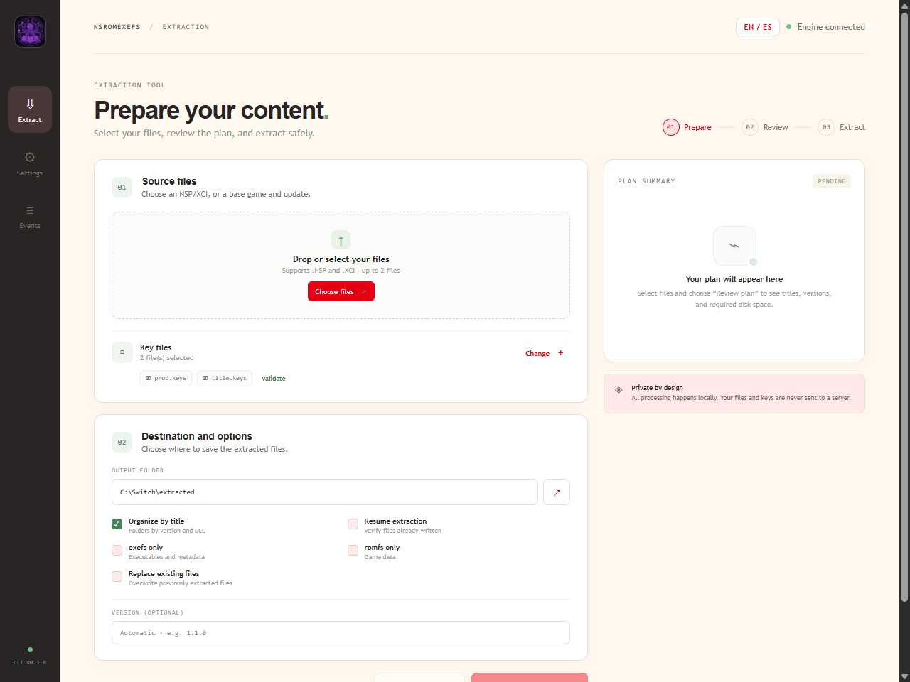

<div align="center">
  
  <h1>nsromexefs</h1>
  <p><strong>Extract <code>exefs</code> and <code>romfs</code> from Nintendo Switch NSP and XCI containers.</strong></p>
  <p>Metadata-aware extraction · BKTR update merging · Verifiable output · Desktop GUI</p>
  <p>
    <a href="https://github.com/SirEdmundiumRockwell/nsromexefs/actions/workflows/ci.yml"></a>
    <a href="LICENSE"></a>
    
    
    
  </p>
  <p>
    <a href="#features">Features</a> ·
    <a href="#quick-start">Quick start</a> ·
    <a href="#desktop-gui">Desktop GUI</a> ·
    <a href="#downloads-and-verification">Downloads</a> ·
    <a href="#build-from-source">Build from source</a> ·
    <a href="#documentation">Documentation</a> ·
    <a href="#credits">Credits</a>
  </p>
</div>

`nsromexefs` turns NSP and XCI containers into clean `exefs/` and `romfs/` trees ready for recompilation, decompilation, or inspection. It identifies base games, updates, and DLC from their CNMT metadata instead of relying on filenames, and can merge supported BKTR updates directly against the base content.

No game content, keys, or console firmware are included. Everything runs locally, and the output includes SHA-256 manifests so you can verify what was extracted.

> [!IMPORTANT]
> **Development note:** This project was created with the assistance of AI tools. The maintainer reviews, tests, and maintains the code. Third-party software and documentation are credited in [`THIRD-PARTY-NOTICES.md`](THIRD-PARTY-NOTICES.md).

> **Status:** v0.1.0. The CLI and the desktop GUI share the same extraction engine. CLI release archives are built by GitHub Actions; the GUI can be packaged as a self-contained installer that bundles the CLI as a sidecar.

## Features

| | |
|---|---|
| **Containers** | Inspect NSP (PFS0) and XCI (HFS0) files, including the update partition inside an XCI. |
| **Metadata first** | Detect title type and version from CNMT metadata. Input order does not matter when combining a base game and its update. |
| **BKTR updates** | Merge supported RomFS updates against the base without writing a full intermediate decrypted NCA. |
| **Clean output** | Write `exefs/`, `romfs/`, `SHA256SUMS`, and `manifest.json` to the destination of your choice. |
| **Batch and trees** | Process folders with `batch`, and organize output by title and version with `--tree`. |
| **Resume and verify** | Resume interrupted extractions after checking existing files, then verify the result with `verify --strict`. |
| **Plan before writing** | Preview titles, versions, and required space with `--dry-run`, or emit machine-readable JSON. |
| **Desktop GUI** | A bilingual Tauri app with a guided workflow, themes, and a persistent local event log. |

## Quick start

1. **Get a build.** Download the CLI archive for your platform from [Releases](https://github.com/SirEdmundiumRockwell/nsromexefs/releases) when available, or [build from source](#build-from-source).

2. **Validate your keys.** `nsromexefs` does not distribute keys. Use only files obtained from your own console and pass them with the repeatable `-k` option. See the [key file guide](docs/keys.md).

   ```console
   nsromexefs keys --check prod.keys title.keys
   ```

3. **Inspect a container** without writing anything:

   ```console
   nsromexefs info "game.nsp" -k "prod.keys" -k "title.keys"
   ```

4. **Extract a base game, update, or XCI:**

   ```console
   nsromexefs dump "game.nsp" -o output -k "prod.keys" -k "title.keys"
   ```

5. **Combine a base game and its update.** The tool identifies them by metadata, so the order does not matter:

   ```console
   nsromexefs dump "game-base.nsp" "game-update.nsp" \
     -o output -k "prod.keys" -k "title.keys"
   ```

6. **Verify or resume an extraction:**

   ```console
   nsromexefs verify output --strict
   nsromexefs dump "game.xci" --tree -o output --resume -k "prod.keys"
   ```

Use `nsromexefs --help` or `nsromexefs <command> --help` for every option.

## Desktop GUI

<p align="center">
  
</p>

The Tauri 2 + Svelte 5 desktop app wraps the same extraction engine and runs entirely on your machine.

- **Bilingual interface:** switch between English and Spanish at any time; the choice is saved locally.
- **Guided workflow:** select inputs, validate keys, review a dry-run plan, extract, and inspect the result.
- **Appearance:** four color palettes and four font styles. The default is *Classic Red and Cream* with the *Rounded* font, inspired by classic console interfaces. No proprietary assets or fonts are bundled.
- **Local event log:** recent actions, warnings, and errors are recorded on the device, with personal paths and key-file names redacted. The log keeps up to 250 entries and can be downloaded or cleared.
- **Bundled engine:** release builds include the CLI as a Tauri sidecar. End users do not need Rust or a separate CLI installation.

Build and run the GUI from `crates/nsromexefs-gui`:

```console
npm install
npm run build:sidecar
npm run tauri dev
```

Build a self-contained installer with:

```console
npm run tauri build
```

The installer is written to the workspace `target/release/bundle` directory and includes the CLI sidecar. See the [GUI development guide](crates/nsromexefs-gui/README.md) for platform prerequisites and the full build workflow.

## Downloads and verification

Release archives are built by GitHub Actions for Windows x64, Linux x64 (glibc), and macOS (Apple Silicon and Intel) when available. Each release includes `SHA256SUMS`; compare the archive digest with its entry before use. Releases are published from reviewed draft releases.

Prebuilt GUI installers are not published yet. `npm run tauri build` produces one locally and bundles the CLI automatically.

> [!WARNING]
> **Windows Smart App Control:** the Windows installers and executables built by this project are not code-signed. Smart App Control may block them even when you built them yourself. If that happens:
>
> - Confirm the file came from this repository's Releases or from your own build, and verify its SHA-256 checksum.
> - You can turn off Smart App Control under **Windows Security → App & browser control → Smart App Control**. Microsoft only allows turning it back on after a clean install or reset of Windows.
> - Only disable it for files you trust. This project does not currently sign its binaries; code signing may be added in the future.

## Build from source

**CLI** — Rust 1.82 or newer. From the repository root:

```console
cargo build --locked --release -p nsromexefs-cli
cargo test --locked -p nsromexefs-core -p nsromexefs-cli
```

The binary is written to `target/release/nsromexefs` (`nsromexefs.exe` on Windows), or under `target/<triple>/release` when you build with an explicit target. Workspace-wide tests also build the GUI crate, which requires the sidecar described below.

**Desktop GUI** — Node.js 22 or newer, Rust 1.90 or newer, and the [Tauri 2 prerequisites](https://v2.tauri.app/start/prerequisites/) for your platform:

```console
cd crates/nsromexefs-gui
npm ci
npm run build:sidecar
npm run check
npm run tauri dev
```

`build:sidecar` compiles the CLI in release mode and copies it to `src-tauri/binaries/`, where Tauri expects the bundled engine. Run it again after changing the CLI.

## Documentation

- [Key file guide](docs/keys.md) — which key files are needed and how to handle them safely.
- [GUI development guide](crates/nsromexefs-gui/README.md) — Tauri setup, sidecar builds, and installer packaging.
- [Technical design](docs/design.es.md) — the original design document (Spanish), covering formats, cryptography, the extraction pipeline, and testing.
- [Third-party notices and attributions](THIRD-PARTY-NOTICES.md).
- [Contributing](CONTRIBUTING.md) and [Security](SECURITY.md).
- [MIT License](LICENSE).

## Project layout

```text
crates/
  nsromexefs-core/       extraction engine (library, no terminal I/O)
  nsromexefs-cli/        command-line interface
  nsromexefs-gui/        Tauri 2 + Svelte 5 desktop app
docs/
  keys.md                key file guide
  design.es.md           technical design (Spanish)
  logo.png               project logo
  screenshot.png         desktop app screenshot
```

## Credits

This project builds on open-source tools, libraries, and publicly documented formats:

- [hactool](https://github.com/SciresM/hactool) by SciresM — NCA, encryption, BKTR, RomFS, and XCI references.
- [nstool](https://github.com/jakcron/nstool) and [libnintendo-hac](https://github.com/jakcron/libnintendo-hac) by jakcron — format structures and cross-validation.
- [switchbrew](https://switchbrew.org) — public format documentation.

Their licenses, applicable notices, and the project's direct dependencies are listed in [`THIRD-PARTY-NOTICES.md`](THIRD-PARTY-NOTICES.md). Rust dependencies are also recorded in `Cargo.lock`.

This project was created with the assistance of AI tools. The maintainer is responsible for reviewing, testing, and maintaining the code. No third-party project is implied to endorse `nsromexefs`.

## Legal and responsible use

This software does not include game content, keys, or console firmware. It is not affiliated with or endorsed by Nintendo. Use it only with content you are legally entitled to access, and comply with applicable laws and the terms governing your content. Nintendo and Nintendo Switch are trademarks of Nintendo Co., Ltd. The user is responsible for their use of the software.

## License

MIT. See [`LICENSE`](LICENSE) and [`THIRD-PARTY-NOTICES.md`](THIRD-PARTY-NOTICES.md).
